# Segmenter results

## Week 1: linear decoder

**Setup:** frozen `facebook/dinov2-small` + one linear layer (3,850 trainable parameters),
10 clue classes, Mapillary Vistas v1.2, images resized to 448x336.
Trained 5 epochs, AdamW, lr 1e-3, batch size 16, on one A100 on Fox (~30 min per run).
Evaluated on the 2,000 Vistas validation images with `evaluate.py`.

### Per-class IoU (mean ± std over seeds 0, 1, 2)

| Class | IoU | Share of pixels |
|---|---|---|
| sky | 0.936 ± 0.001 | 30.4% |
| road | 0.831 ± 0.002 | 21.0% |
| vegetation_and_terrain | 0.792 ± 0.001 | 17.4% |
| vehicles | 0.790 ± 0.001 | 4.3% |
| buildings_and_structures | 0.771 ± 0.002 | 14.3% |
| barriers_and_sidewalk | 0.573 ± 0.010 | 6.9% |
| people | 0.533 ± 0.003 | 0.4% |
| signs_and_text | 0.451 ± 0.003 | 1.3% |
| road_markings | 0.350 ± 0.020 | 2.2% |
| poles_and_street_furniture | 0.252 ± 0.001 | 1.8% |
| **mean IoU** | **0.628 ± 0.003** | |
| **pixel accuracy** | **0.884 ± 0.001** | |
| val loss | 0.321 ± 0.002 | |

### Per seed

| Seed | Val loss | Mean IoU | Pixel accuracy | Training job |
|---|---|---|---|---|
| 0 | 0.3199 | 0.6306 | 0.8853 | 4316734 |
| 1 | 0.3209 | 0.6246 | 0.8842 | 4318395 |
| 2 | 0.3228 | 0.6285 | 0.8837 | 4318397 |

Checkpoints: `/fp/projects01/ec674/williaan/checkpoints/linear_seed{0,1,2}.pt` (Fox).
Raw evaluation output: `/fp/projects01/ec674/williaan/results/linear_seed{0,1,2}.txt` (Fox).

### Observations

- The seed barely matters: most classes vary by less than 0.003 IoU, so differences
  larger than that in week 2 are real improvements.
- Training levels off after about 2 epochs, with train and val loss nearly equal (no overfitting).
  A linear layer on frozen features has reached its limit; more epochs will not help.
- Large classes are good (sky, road, vegetation, vehicles, buildings: 0.77-0.94).
- Thin and small classes are weak: poles 0.25, road markings 0.35, signs 0.45.
  The decoder predicts once per 14x14 patch, and poles and lines are often thinner than a patch.
  These are likely strong location clues, so week 3's "blur one class" only removes part of them
  with this model. Improving them is the goal of week 2 (mask transformer + class weights).
- People score 0.53 despite being only 0.4% of pixels.
- Pixel accuracy hides the weak classes (sky and road are half of all pixels),
  so mean IoU is the main number to compare from now on.
- The Vistas test split is not available, so the validation set is used both to pick the
  best epoch and to report results. For a linear decoder this bias is negligible.

## Week 2: Segmenter decoder and class weights

**Setup:** same frozen `facebook/dinov2-small`, data, image size and evaluation as week 1.
Two changes were tested separately and together:

- **Segmenter decoder** (Strudel et al. 2021, mask transformer): 10 learnable class tokens and
  2 transformer layers over the patch tokens, then each patch is scored by its cosine similarity
  to each class token. About 4.0M trainable parameters (week 1: 3,850).
  Trained 10 epochs, AdamW, lr 1e-4.
- **Class weights** in the loss: 1/sqrt(pixel share), scaled to average 1, so mistakes on small
  classes count more (poles 1.32, signs 1.55, people 2.80, sky 0.32).

The best epoch is now picked by validation mean IoU instead of loss, since weighted and
unweighted losses are not comparable.

**Mask2Former reference:** the pretrained `facebook/mask2former-swin-large-mapillary-vistas-semantic`,
not trained by us. It is run on the same validation images upscaled to 896x672, its 65 Vistas
classes are summed into our 10 clue classes with the week 1 mapping, and it is scored at 448x336
with the same `confusion_matrix()` as our models (`mask2former_eval.py`).

### All week 2 runs (IoU per class)

Best of our own four models in **bold**. Mask2Former is a reference only.

| Class | Share of pixels | Linear (week 1) | Linear + weights | Segmenter | Segmenter + weights | Mask2Former |
|---|---:|---:|---:|---:|---:|---:|
| road | 21.0% | 0.831 | 0.813 | **0.861** | 0.850 | 0.920 |
| road_markings | 2.2% | 0.350 | 0.397 | 0.430 | **0.460** | 0.680 |
| signs_and_text | 1.3% | 0.451 | 0.423 | **0.474** | 0.465 | 0.671 |
| poles_and_street_furniture | 1.8% | 0.252 | 0.281 | 0.281 | **0.310** | 0.636 |
| buildings_and_structures | 14.3% | 0.771 | 0.762 | **0.801** | 0.792 | 0.882 |
| barriers_and_sidewalk | 6.9% | 0.573 | 0.587 | 0.658 | **0.664** | 0.786 |
| vegetation_and_terrain | 17.4% | 0.792 | 0.789 | **0.829** | 0.821 | 0.905 |
| sky | 30.4% | 0.936 | 0.930 | **0.948** | 0.934 | 0.978 |
| vehicles | 4.3% | 0.790 | 0.781 | **0.811** | 0.798 | 0.911 |
| people | 0.4% | 0.533 | 0.464 | **0.543** | 0.475 | 0.778 |
| **mean IoU** | | 0.628 | 0.623 | **0.664** | 0.657 | 0.815 |
| **pixel accuracy** | | 0.884 | 0.874 | **0.904** | 0.893 | 0.948 |

Week 1 linear is the mean of seeds 0, 1, 2. The week 2 runs are seed 0 only; week 1 showed
seed-to-seed differences of about 0.003 mean IoU.

### Effect of class weights (IoU with weights minus without)

| Class | Weight | Linear | Segmenter |
|---|---:|---:|---:|
| road | 0.39 | -0.018 | -0.011 |
| road_markings | 1.19 | **+0.047** | **+0.030** |
| signs_and_text | 1.55 | -0.028 | -0.009 |
| poles_and_street_furniture | 1.32 | **+0.029** | **+0.029** |
| buildings_and_structures | 0.47 | -0.009 | -0.009 |
| barriers_and_sidewalk | 0.67 | +0.014 | +0.006 |
| vegetation_and_terrain | 0.42 | -0.003 | -0.008 |
| sky | 0.32 | -0.006 | -0.014 |
| vehicles | 0.85 | -0.009 | -0.013 |
| people | 2.80 | **-0.069** | **-0.068** |
| **mean IoU** | | -0.005 | -0.007 |

### Week 1 vs best of week 2 vs Mask2Former

The Segmenter decoder without class weights has the highest mean IoU and is the main model for week 3.

| Class | Week 1 linear | Week 2 Segmenter | Change | Mask2Former | Gap to Mask2Former |
|---|---:|---:|---:|---:|---:|
| road | 0.831 ± 0.002 | 0.861 | +0.030 | 0.920 | 0.059 |
| road_markings | 0.350 ± 0.020 | 0.430 | **+0.080** | 0.680 | 0.250 |
| signs_and_text | 0.451 ± 0.003 | 0.474 | +0.023 | 0.671 | 0.197 |
| poles_and_street_furniture | 0.252 ± 0.001 | 0.281 | +0.029 | 0.636 | **0.355** |
| buildings_and_structures | 0.771 ± 0.002 | 0.801 | +0.030 | 0.882 | 0.081 |
| barriers_and_sidewalk | 0.573 ± 0.010 | 0.658 | **+0.085** | 0.786 | 0.128 |
| vegetation_and_terrain | 0.792 ± 0.001 | 0.829 | +0.037 | 0.905 | 0.076 |
| sky | 0.936 ± 0.001 | 0.948 | +0.012 | 0.978 | 0.030 |
| vehicles | 0.790 ± 0.001 | 0.811 | +0.021 | 0.911 | 0.100 |
| people | 0.533 ± 0.003 | 0.543 | +0.010 | 0.778 | 0.235 |
| **mean IoU** | **0.628 ± 0.003** | **0.664** | **+0.036** | **0.815** | **0.151** |
| **pixel accuracy** | 0.884 ± 0.001 | 0.904 | +0.020 | 0.948 | 0.044 |

### Training runs

| Run | Epochs | lr | Best epoch | Best val mIoU | Training job |
|---|---:|---:|---:|---:|---|
| Linear + weights | 5 | 1e-3 | 4 | 0.6228 | 4343069 |
| Segmenter | 10 | 1e-4 | 8 | 0.6635 | 4343070 |
| Segmenter + weights | 10 | 1e-4 | 9 | 0.6569 | 4343071 |

Checkpoints: `/fp/projects01/ec674/williaan/checkpoints/{linear_weighted,segmenter,segmenter_weighted}_seed0.pt` (Fox).
Raw evaluation output: `/fp/projects01/ec674/williaan/results/` (Fox), including `mask2former.txt`.

### Example predictions

The four validation images (out of the first 300) with the largest share of sign and pole pixels,
made with `visualize.py`. Unlabelled pixels are black in every column, so only scored pixels are compared.

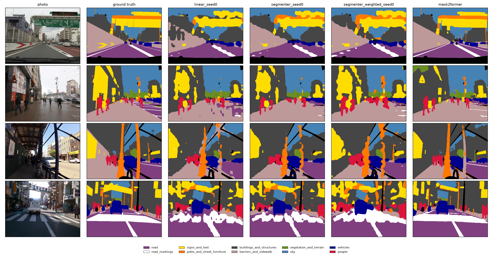

- **Row 1, overhead sign gantry:** the linear decoder breaks the gantry into scattered patches. The
  Segmenter draws it as one connected region. With class weights, more of the gantry's frame is
  labelled as poles (orange), in line with the +0.029 for poles. The chevron signs on the left barrier
  are mostly missed by all models.
- **Row 2, shopping street with people:** the linear decoder gives a speckled sidewalk, with patches
  of road scattered over the pavement. The Segmenter makes the sidewalk one clean region, which is the
  context from the transformer layers and matches the +0.085 for barriers and sidewalk. With class weights
  the people (red) are drawn clearly larger than in the ground truth: this is the over-prediction behind
  the -0.068 for people. Weights also pick up the utility pole on the right, which the other two miss.
- **Row 3, scaffolding:** all models find the thick scaffolding poles, and they are most complete
  with class weights. The people under the scaffolding again become larger blobs with weights.
- **Row 4, zebra crossing:** no model draws the separate stripes; the crossing becomes one white blob.
  Each stripe and gap is thinner than one 14x14 patch, so a decoder that predicts once per patch cannot
  separate them. The thin poles on the right are also mostly missed. This is the resolution limit that
  also shows in the gap to Mask2Former on thin classes.
- **All rows:** predicted regions have rounded, blobby edges compared with the ground truth, because the
  scores come from a 32x24 patch grid that is upsampled to 448x336.

### Observations

- The Segmenter decoder improves every class over the linear decoder (mean IoU 0.628 -> 0.664,
  about 10x the seed noise). The largest gains are barriers and sidewalk (+0.085) and road markings
  (+0.080): the transformer layers let each patch use the patches around it, and a kerb or a line
  is easier to recognise next to the road.
- Class weights move accuracy between classes instead of adding it, with the same pattern in both
  decoders: road markings and poles gain about 0.03, people lose about 0.07, mean IoU drops slightly.
  People have the highest weight (2.80) and are likely over-predicted, which IoU punishes as much as
  misses. A softer weighting is possible future work.
- With both changes, poles reach 0.310 and road markings 0.460, the best of our models on those
  classes (week 1: 0.252 and 0.350).
- Poles are still the weakest class, at under half of Mask2Former's IoU (0.281 vs 0.636), and the gap
  to Mask2Former is largest on thin classes. This matches the week 1 diagnosis: the decoder predicts
  once per 14x14 patch, and poles and lines are often thinner than that. Higher input resolution is
  the clearest next step.
- Mask2Former is much larger (Swin-L, fully trained at high resolution) than our frozen DINOv2-small
  with a trained decoder, so it is a reference for what is possible, not a like-for-like competitor.
- The Segmenter without weights levelled off at about 0.66 after 6-9 epochs. With weights it was still
  improving at epoch 9, so it might catch up with more epochs.
- Plan B (keep the linear decoder) is not needed: the Segmenter decoder replaces it for week 3.

## Higher resolution (672x504)

**Setup:** the week 2 Segmenter (no class weights), with the input size raised from 448x336 to 672x504
(`--size 672 504`). That gives a 48x36 patch grid instead of 32x24, so each 14x14 patch covers a smaller
part of the scene and thin things like poles span more patches. Same frozen `facebook/dinov2-small`,
10 epochs, AdamW, lr 1e-4, seed 0. Training job 4351263, 1 h 23 min on one GPU, peak memory 7.9 GB.

**Why 672x504:** a safe first step up, not a tuned choice.

- Both sides must be multiples of DINOv2's 14-pixel patch; 672x504 is exactly 48x36 patches and keeps
  the 4:3 shape of 448x336 (1.5x each side).
- DINOv2 was pretrained at 518x518 (about 1,370 patches). 1,728 patches is close to that, so the frozen
  features should still work well; much larger inputs move further from what the backbone was trained on.
- Attention cost grows with the square of the number of patches: about 5x the 448x336 cost here, and
  about 16x at 896x672.
- In week 3 the masks are also predicted for every test photo at this size, inside a GPU budget of
  under 1 hour.

Since poles were still clearly improving, 896x672 (3,072 patches, the size Mask2Former runs at) is
tested next to see whether the gains continue or level off.

### Training curve

| Epoch | Train loss | Val loss | Val pixel acc | Val mIoU |
|---:|---:|---:|---:|---:|
| 0 | 0.5615 | 0.4647 | 0.8981 | 0.6534 |
| 1 | 0.4245 | 0.3901 | 0.9063 | 0.6754 |
| 2 | 0.3640 | 0.3446 | 0.9104 | 0.6809 |
| 3 | 0.3231 | 0.3109 | 0.9137 | 0.6929 |
| 4 | 0.2940 | 0.2893 | 0.9150 | 0.6963 |
| 5 | 0.2723 | 0.2729 | 0.9157 | 0.7045 |
| 6 | 0.2546 | 0.2597 | 0.9169 | 0.7059 |
| 7 | 0.2403 | 0.2543 | 0.9172 | 0.7049 |
| 8 | 0.2288 | 0.2429 | 0.9193 | 0.7080 |
| 9 | 0.2190 | 0.2384 | 0.9192 | **0.7104** |

Best epoch 9, val mIoU 0.7104 (week 2 Segmenter at 448x336: 0.6635).
Checkpoint: `/fp/projects01/ec674/williaan/checkpoints/segmenter_672_seed0.pt` (Fox).

### Per-class IoU

Evaluation job 4351510 (`evaluate.py --size 672 504`, 1 min 44 s). Largest gains in **bold**.

| Class | Share of pixels | Segmenter 448x336 | Segmenter 672x504 | Change | Mask2Former | Gap to Mask2Former |
|---|---:|---:|---:|---:|---:|---:|
| road | 21.0% | 0.861 | 0.876 | +0.015 | 0.920 | 0.044 |
| road_markings | 2.2% | 0.430 | 0.478 | +0.048 | 0.680 | 0.202 |
| signs_and_text | 1.3% | 0.474 | 0.548 | **+0.074** | 0.671 | 0.123 |
| poles_and_street_furniture | 1.8% | 0.281 | 0.374 | **+0.093** | 0.636 | 0.262 |
| buildings_and_structures | 14.3% | 0.801 | 0.832 | +0.031 | 0.882 | 0.050 |
| barriers_and_sidewalk | 6.9% | 0.658 | 0.701 | +0.043 | 0.786 | 0.085 |
| vegetation_and_terrain | 17.4% | 0.829 | 0.860 | +0.031 | 0.905 | 0.045 |
| sky | 30.4% | 0.948 | 0.958 | +0.010 | 0.978 | 0.020 |
| vehicles | 4.3% | 0.811 | 0.856 | +0.045 | 0.911 | 0.055 |
| people | 0.4% | 0.543 | 0.620 | **+0.077** | 0.778 | 0.158 |
| **mean IoU** | | 0.664 | **0.710** | **+0.046** | 0.815 | 0.105 |
| **pixel accuracy** | | 0.904 | **0.919** | +0.015 | 0.948 | 0.029 |

Raw evaluation output: `/fp/projects01/ec674/williaan/results/segmenter_672_seed0.txt` (Fox).

### Observations

- Mean IoU rises from 0.664 to 0.710 (+0.046), more than the decoder change in week 2 (+0.036) and about
  15x the seed noise. It closes about 30% of the gap to Mask2Former (0.815).
- Every class improves, and the small, thin classes gain the most: poles +0.093 (a third higher, and
  above the 0.310 of Segmenter + weights), people +0.077, signs +0.074. Big classes like sky and road
  gain only 0.01-0.02. This supports the week 1 and 2 diagnosis that the 14x14 patch size was the main
  limit for thin classes.
- Poles are still the weakest class and have the largest gap to Mask2Former (0.262), followed by road
  markings (0.202). These are still often thinner than one patch at 672x504.
- This was the best model at the time and replaced `segmenter_seed0`; the 896x672 model below replaces it in turn.
- Val loss fell every epoch and mIoU was still rising at epoch 9, with train and val loss close together
  (no overfitting), so more epochs would likely help a little more.
- Not a perfectly like-for-like comparison: this model is scored on 672x504 masks, the week 2 models on
  448x336 masks. Thin objects lose fewer pixels when masks are downscaled less, so part of the gain may
  come from the finer masks rather than the model. The pixel share of every class is the same at both
  sizes (to 0.1%), so the answer keys contain the same classes in the same amounts and this effect is
  probably small. Scoring both models on the same mask size would settle it.
- Cost: about 1.4x the training time of the 448x336 run and about 2.25x the patches per image, which
  matters for the week 3 GPU budget if masks are predicted at this size.

## Higher resolution (896x672)

**Setup:** the same Segmenter at `--size 896 672` (64x48 = 3,072 patches, 4x the 448x336 grid and the
size Mask2Former runs at), to see whether the gain from 672x504 continues. 10 epochs, lr 1e-4, seed 0.
Training job 4362947.

### Training curve

| Epoch | Train loss | Val loss | Val pixel acc | Val mIoU |
|---:|---:|---:|---:|---:|
| 0 | 0.5391 | 0.4437 | 0.9060 | 0.6769 |
| 1 | 0.4028 | 0.3666 | 0.9147 | 0.7015 |
| 2 | 0.3420 | 0.3214 | 0.9187 | 0.7051 |
| 3 | 0.3010 | 0.2911 | 0.9210 | 0.7171 |
| 4 | 0.2722 | 0.2678 | 0.9228 | 0.7208 |
| 5 | 0.2505 | 0.2515 | 0.9237 | 0.7283 |
| 6 | 0.2332 | 0.2392 | 0.9246 | 0.7314 |
| 7 | 0.2200 | 0.2342 | 0.9245 | 0.7290 |
| 8 | 0.2084 | 0.2231 | 0.9273 | **0.7351** |
| 9 | 0.1997 | 0.2214 | 0.9260 | 0.7334 |

Best epoch 8, val mIoU 0.7351.
Checkpoint: `/fp/projects01/ec674/williaan/checkpoints/segmenter_896_seed0.pt` (Fox).

### Per-class IoU at all three sizes

`evaluate.py --size 896 672`. Change is 896x672 minus 672x504; largest gains in **bold**.

| Class | Share of pixels | 448x336 | 672x504 | 896x672 | Change | Mask2Former | Gap to Mask2Former |
|---|---:|---:|---:|---:|---:|---:|---:|
| road | 21.0% | 0.861 | 0.876 | 0.886 | +0.010 | 0.920 | 0.034 |
| road_markings | 2.2% | 0.430 | 0.478 | 0.528 | **+0.050** | 0.680 | 0.152 |
| signs_and_text | 1.3% | 0.474 | 0.548 | 0.582 | +0.034 | 0.671 | 0.089 |
| poles_and_street_furniture | 1.8% | 0.281 | 0.374 | 0.419 | **+0.045** | 0.636 | 0.217 |
| buildings_and_structures | 14.3% | 0.801 | 0.832 | 0.849 | +0.017 | 0.882 | 0.033 |
| barriers_and_sidewalk | 6.9% | 0.658 | 0.701 | 0.715 | +0.014 | 0.786 | 0.071 |
| vegetation_and_terrain | 17.4% | 0.829 | 0.860 | 0.876 | +0.016 | 0.905 | 0.029 |
| sky | 30.4% | 0.948 | 0.958 | 0.965 | +0.007 | 0.978 | 0.013 |
| vehicles | 4.3% | 0.811 | 0.856 | 0.872 | +0.016 | 0.911 | 0.039 |
| people | 0.4% | 0.543 | 0.620 | 0.659 | **+0.039** | 0.778 | 0.119 |
| **mean IoU** | | 0.664 | 0.710 | **0.735** | +0.025 | 0.815 | 0.080 |
| **pixel accuracy** | | 0.904 | 0.919 | **0.927** | +0.008 | 0.948 | 0.021 |

Raw evaluation output: `/fp/projects01/ec674/williaan/results/segmenter_896_seed0.txt` (Fox).

### Resolution summary (val mIoU, Segmenter, no class weights)

| Size | Patches | Best val mIoU | Gain |
|---|---:|---:|---:|
| 448x336 | 768 | 0.664 | |
| 672x504 | 1,728 | 0.710 | +0.046 |
| 896x672 | 3,072 | 0.735 | +0.025 |

### Observations

- Higher resolution still helps, but less each step: +0.046 from 448 to 672, then +0.025 from 672 to 896,
  although the second step adds more patches. Going further would cost a lot more compute for a small gain.
- At 896x672 mIoU levelled off (0.731-0.735 over epochs 6-9), unlike at 672x504 where it was still rising.
- Thin and small classes again gain the most: road markings +0.050, poles +0.045, people +0.039, while
  sky and road gain under 0.01. From 448x336 to 896x672 poles went from 0.281 to 0.419 (+49%) and road
  markings from 0.430 to 0.528. The gap to Mask2Former shrank from 0.151 to 0.080 mean IoU.
- Poles are still the weakest class and furthest from Mask2Former (0.217). Week 3 masks for poles are
  therefore the least complete, so blurring "poles" leaves some poles sharp.
- The same caveat about mask size applies: this model is scored on 896x672 masks.
- This is now the best model and the main model for week 3 (`segmenter_896_seed0`). The week 3 test
  photos are few (about 1,400), so predicting at this size costs only minutes of GPU.

## Week 3: does the segmenter work on OSV-5M?

The week 3 photos have no segmentation labels, so the pretrained Mask2Former is used as the reference
answer: IoU between our masks and Mask2Former's, per clue class (`agreement.py`, job 4371440).
Pixels Mask2Former assigns to a Vistas class we ignore (camera car, unlabelled) are left out.
The same is measured on 500 Vistas validation photos as a control, because Mask2Former is not perfect
either. Model: `segmenter_896_seed0`, both models see the photos at 896x672.

**OSV-5M test set:** 1,233 photos from the first test shard, up to 200 per continent (Christmas Island
counted as Oceania, so Oceania has 233), made with `test_sets.py`.

| Class | Vistas: IoU | Vistas: pixels | OSV-5M: IoU | OSV-5M: pixels | Change |
|---|---:|---:|---:|---:|---:|
| road | 0.880 | 20.3% | 0.870 | 18.6% | -0.010 |
| road_markings | 0.561 | 2.1% | 0.433 | 0.9% | -0.128 |
| signs_and_text | 0.566 | 1.2% | 0.508 | 0.2% | -0.058 |
| poles_and_street_furniture | 0.421 | 2.0% | 0.287 | 0.4% | -0.134 |
| buildings_and_structures | 0.853 | 14.7% | 0.540 | 2.5% | **-0.313** |
| barriers_and_sidewalk | 0.720 | 7.9% | 0.492 | 1.6% | **-0.228** |
| vegetation_and_terrain | 0.876 | 17.0% | 0.894 | 35.5% | +0.018 |
| sky | 0.968 | 30.0% | 0.963 | 38.8% | -0.005 |
| vehicles | 0.832 | 4.3% | 0.527 | 1.4% | **-0.305** |
| people | 0.683 | 0.5% | 0.661 | 0.1% | -0.022 |
| **mean IoU** | **0.736** | | **0.617** | | -0.119 |
| **pixel accuracy** | 0.926 | | 0.938 | | +0.012 |

Pixels = share of pixels per class in Mask2Former's masks. Our own masks give similar shares on OSV-5M
(sky 36.9%, vegetation 33.9%, road 22.9%, buildings 1.6%, vehicles 2.0%; `predict.py`, job 4371439).

### Observations

- On Vistas the agreement (0.736) is almost the same as our true mIoU (0.735), so Mask2Former is a
  reasonable stand-in for labels.
- The large classes that make up most OSV-5M photos (road, vegetation, sky) agree as well as on Vistas,
  so overall pixel accuracy is even higher (0.938).
- OSV-5M photos are mostly roads through open landscape: buildings are 2.5% of pixels instead of 14.7%,
  vehicles 1.4% instead of 4.3%. These classes, and barriers, drop by 0.23-0.31 IoU. Part of this is
  probably that IoU is harsher on classes that are small in each photo (the edge pixels are a larger
  share), and part is a real domain shift (other countries, cameras and image quality than Vistas).
- Thin classes drop by about 0.13 (road markings, poles); signs and people hold up better.
- Consequence for week 3: the masks for road, vegetation and sky are as reliable as on Vistas, but
  buildings, vehicles, barriers, poles and road markings are only partly found, so blurring them leaves
  some of the class sharp. The clue effect of those classes is therefore likely an underestimate.
- Looking at previews by eye: masks are clean on open roads and in towns (signs, poles, parking lines and
  railings are found), but the camera car's own bonnet and dashboard are labelled vehicle or road. The
  camera car was ignored in training, so the model never learned it. "Blur vehicles" therefore also blurs
  the camera car in some photos.

## Week 3: which clues give the location away (OSV-5M)

**Setup (`class_blur.py`, `clue_ranking.py`):** geolocation model = the OSV-5M baseline (CLIP ViT-L),
the same stand-in Victoria uses. It sees the centre square of each photo (resize to 224, centre crop),
so blurring and areas are computed on that square (448x448, blur sigma 40 = Victoria's sigma 20 at 224).
For each of the 1,233 OSV-5M photos the model guesses 21 versions: the original, each clue class
blurred (masks from `segmenter_896_seed0`, grown by 5 px), and for each class a random region of the
same area blurred (smooth random blobs).

- **blur +km / random +km:** mean increase in error when the class / the random region is blurred.
- **Clue effect = blur +km - random +km**, per photo, averaged over the photos that contain the class
  (at least 0.1% of the square). This removes the effect of simply blurring a lot of the photo.
- **95% interval:** bootstrap over photos. If it does not include 0, the effect is bigger than chance.

**Without blur:** 0.2% within 1 km, 16.5% within 25 km, 46.4% within 200 km, 65.1% within 750 km,
79.2% within 2500 km, median error 250 km.

### Clue ranking, all photos

| Class | Photos | Area | Blur +km | Random +km | Clue effect km (95% interval) | <750 km: before / blur / random |
|---|---:|---:|---:|---:|---|---|
| vegetation_and_terrain | 1230 | 31.8% | 4648 | 1869 | **+2779** (2419 to 3124) | 65% / **15%** / 38% |
| buildings_and_structures | 341 | 7.4% | 578 | 144 | **+434** (109 to 797) | 63% / 53% / 57% |
| people | 120 | 1.8% | 141 | -19 | +161 (-357 to 654) | 53% / 52% / 53% |
| road | 1181 | 30.3% | 2400 | 2247 | +153 (-199 to 477) | 66% / 36% / 37% |
| signs_and_text | 320 | 1.2% | 177 | 50 | +127 (-171 to 428) | 69% / 66% / 67% |
| poles_and_street_furniture | 538 | 1.6% | 229 | 200 | +29 (-237 to 315) | 67% / 63% / 64% |
| vehicles | 643 | 5.2% | 445 | 428 | +16 (-229 to 273) | 66% / 60% / 61% |
| road_markings | 758 | 3.1% | 439 | 449 | -10 (-257 to 224) | 73% / 68% / 66% |
| barriers_and_sidewalk | 545 | 4.4% | 155 | 413 | -258 (-580 to 34) | 68% / 64% / 62% |
| sky | 1212 | 43.1% | 1805 | 2985 | **-1180** (-1477 to -883) | 66% / 40% / 28% |

### Clue effect per continent (km)

`*` = 95% interval does not include 0. Empty = class in fewer than 20 photos of that continent.
Oceania includes 33 photos from Christmas Island.

| Class | Africa (200) | Asia (200) | Europe (200) | North America (200) | Oceania (233) | South America (200) |
|---|---:|---:|---:|---:|---:|---:|
| road | 36 | -597 | -184 | -8 | **1432*** | -10 |
| road_markings | -335 | -680* | 127 | **712*** | -93 | -164 |
| signs_and_text | -295 | **418*** | 103 | -10 | -449 | 498 |
| poles_and_street_furniture | -35 | 234 | 57 | -391 | 178 | 85 |
| buildings_and_structures | 139 | **826*** | 312 | 462 | **1563*** | -497 |
| barriers_and_sidewalk | -121 | -166 | 23 | -628 | -303 | -430 |
| vegetation_and_terrain | **2515*** | **2817*** | **2777*** | **772*** | **5651*** | **1658*** |
| sky | -765* | -496 | -226 | -3062* | -828 | -1705* |
| vehicles | 539 | 508 | 28 | -497 | 25 | -655 |
| people | 177 | 181 | | | | |

Raw output: `/fp/projects01/ec674/williaan/results/clue_ranking_osv5m.txt`, per-photo rows in
`class_blur_osv5m.csv` (Fox). GPU: masks 3 min (job 4371439), agreement check 4 min (job 4371440),
class blur one job.

### Observations

- **Vegetation and terrain is by far the strongest clue**, on every continent and always bigger than
  chance. Blurring it drops the share of photos guessed within 750 km from 65% to 15%, against 38% for
  a random region of the same size. The baseline relies heavily on landscape and climate (plants, soil,
  open terrain), which fits OSV-5M being mostly roads through open country.
- **Buildings are the only other clear clue overall** (+434 km), strongest in Asia and Oceania. Their
  masks are only partly complete on OSV-5M (agreement 0.54), so the real effect is likely larger.
- **Sky is the least informative class:** blurring it hurts much less than blurring the same area at
  random (-1180 km). This was planned as a control in `clue_classes.py`, and it shows the area control
  works: a random region of 43% of the photo also covers informative content, sky does not.
- **Road** hurts a lot when blurred (+2400 km), but almost exactly as much as a random region of the
  same size, so overall it matters through its area, not its content. In Oceania it is a clear clue
  (+1432 km*), possibly the red dirt roads of Australia.
- **Small classes (signs, poles, road markings, people) show no clear overall effect.** They cover only
  1-3% of each photo, so the intervals are wide (about ±300 km), and their masks are the least
  complete. "Not shown" here is not the same as "not a clue".
- **Some per-continent effects match known geolocation clues:** road markings in North America (+712*,
  yellow centre lines) and signs in Asia (+418*, non-Latin scripts). With 60 cells, about 3 cells are
  expected to be marked * by chance, so single cells should be read with care; vegetation, which is
  significant in all six continents, is robust.
- The top-3 lists printed by `clue_ranking.py` include effects that are not significant, so the table
  with `*` is the one to use.

### Limitations

- Results are for the OSV-5M baseline; Abdu's ViT may rely on other clues (planned rerun).
- Masks for small classes are incomplete on OSV-5M, and "vehicles" also covers the camera car.
- Means of km changes are sensitive to a few photos with very large changes; the bootstrap intervals
  account for this, but medians or accuracy changes are more robust alternatives.
- Im2GPS is not done yet (photos needed from Victoria).

## Week 4: where does the model look? (heatmaps vs blur, OSV-5M)

**Setup (`heatmaps.py`, `heatmap_ranking.py`):** same OSV-5M baseline, 1,233 photos and 448x448 centre
square as week 3. For each photo, a 64x64 window (2% of the square) is blurred (sigma 40), moved 16 px at
a time: 27 x 27 = 729 guesses per photo. Each pixel's heat is the mean km the guess moves away from the
original guess, over the windows that cover it. GPU job 4395188, 2.1 h. Masks from `segmenter_896_seed0`
(not grown, unlike week 3's 5 px).

- **Heat ratio** = mean heat on the class's pixels / mean heat of the photo. Per pixel: 1 = as much as an
  average pixel.
- **Excess heat** = (heat ratio - 1) x area. For the whole class: how much more of the heatmap it holds
  than an average region of the same size. This is the heatmap version of week 3's clue effect
  (class vs random region of the same size), so it is the number to compare with the blur ranking.
- **95% interval:** bootstrap over photos, as in week 3.

### Heat ranking, all photos

| Class | Photos | Area | Heat ratio (95% interval) | Excess heat (95% interval) | Blur rank (week 3) |
|---|---:|---:|---|---|---:|
| vegetation_and_terrain | 1228 | 27.8% | 1.40 (1.35 to 1.44) | **+0.058** (0.052 to 0.064) | 1 |
| buildings_and_structures | 304 | 6.0% | 1.54 (1.36 to 1.79) | **+0.008** (0.001 to 0.014) | 2 |
| signs_and_text | 198 | 1.0% | 1.90 (1.57 to 2.32) | **+0.006** (0.004 to 0.010) | 5 |
| barriers_and_sidewalk | 448 | 3.3% | 1.14 (1.05 to 1.24) | +0.002 (-0.001 to 0.006) | 9 |
| people | 81 | 1.5% | 1.92 (1.36 to 2.66) | +0.002 (-0.001 to 0.006) | 3 |
| poles_and_street_furniture | 314 | 0.9% | 1.49 (1.34 to 1.66) | **+0.002** (0.001 to 0.003) | 6 |
| vehicles | 550 | 4.2% | 1.69 (1.44 to 1.97) | +0.001 (-0.004 to 0.006) | 7 |
| road_markings | 685 | 1.4% | 0.89 (0.82 to 0.97) | **-0.002** (-0.003 to -0.001) | 8 |
| sky | 1208 | 41.0% | 1.02 (0.99 to 1.05) | **-0.017** (-0.025 to -0.008) | 10 |
| road | 1173 | 27.7% | 0.87 (0.84 to 0.90) | **-0.048** (-0.056 to -0.041) | 4 |

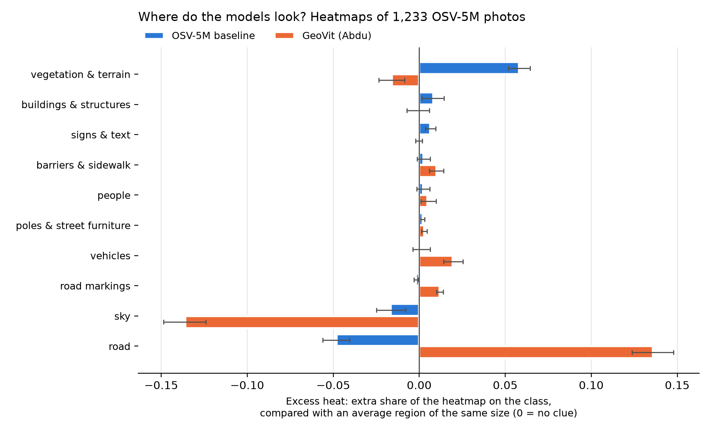

**Rank correlation with the week 3 blur ranking (Spearman, 10 classes):** 0.58 with excess heat,
0.37 with heat ratio.

**Per continent:** vegetation has a clearly positive excess heat on all six continents, road a clearly
negative one on all six. Signs are clearly positive in Asia, Europe, North America and South America.
Full table: `/fp/projects01/ec674/williaan/results/heatmap_ranking_osv5m.txt` (Fox). In the test CSV the
33 Christmas Island photos are labelled "Other" (the week 3 table above counted them under Oceania).

### Examples

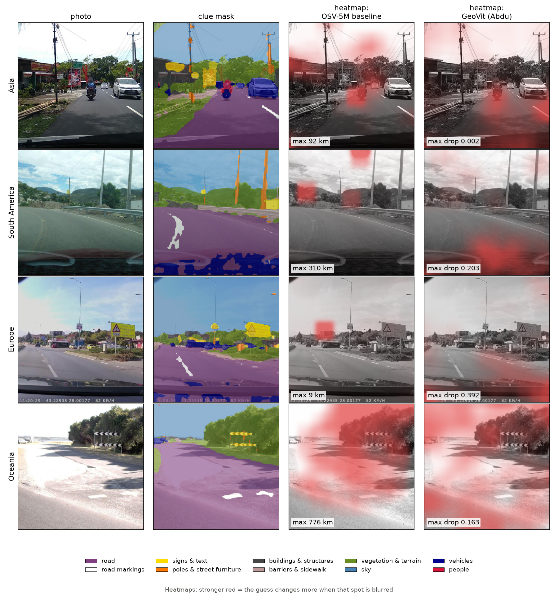

Grey photo with red where blurring a window moves the guess most, scaled per photo (the corner shows the
hottest spot in km) and lightly smoothed for display. The rankings use the raw heat.

### Week 3 blur ranking with three segmenter seeds

The class blur experiment was repeated with the masks of `segmenter_896_seed1` and `seed2`
(class blur jobs 4404343 and 4404344). Clue effect in km, `*` = 95% interval does not include 0:

| Class | Seed 0 | Seed 1 | Seed 2 | Mean ± std |
|---|---:|---:|---:|---:|
| vegetation_and_terrain | 2779* | 2623* | 2681* | **2694 ± 79** |
| buildings_and_structures | 434* | 366 | 252 | 351 ± 92 |
| people | 161 | 229 | 556* | 315 ± 211 |
| road | 153 | 207 | 143 | 168 ± 34 |
| poles_and_street_furniture | 29 | 196 | 272* | 166 ± 124 |
| signs_and_text | 127 | 141 | 103 | 124 ± 19 |
| vehicles | 16 | 64 | -17 | 21 ± 41 |
| road_markings | -10 | -37 | 92 | 15 ± 68 |
| barriers_and_sidewalk | -258 | -321* | -256 | -278 ± 37 |
| sky | -1180* | -1181* | -976* | **-1112 ± 118** |

Without blur the three runs give 65.1% / 65.0% / 65.0% within 750 km (median 250 / 249 / 249 km). The
original photo is the same in all three, so this is GPU rounding from being batched with different
blurred versions, not a real difference.
Raw output: `clue_ranking_osv5m_seed{1,2}.txt` (Fox).

### Observations

- **Both methods agree on the main result:** vegetation and terrain is the strongest clue and buildings
  the second, and sky gives little away. Two different ways of hiding content giving the same answer
  makes this robust.
- **Vegetation and sky are stable across the three segmenter seeds**; vegetation has the smallest spread
  relative to its size (2694 ± 79 km). The middle of the blur ranking is not: buildings are only
  significant with seed 0, people and poles only with seed 2. The order of the middle classes should not
  be over-interpreted.
- **Road disagrees most:** 4th by blur (+153 km, not significant), last by heat, and negative on every
  continent. Blurring all of the road hurts about as much as blurring the same area at random, while
  blurring any single road patch barely moves the guess: the model does not look at the road surface
  itself.
- **Signs are a clear clue by heat but not by blur.** Heat looks at one spot at a time, so small objects
  get a fair test. When a whole class is blurred, the effect of a few small signs is drowned by noise
  (week 3 intervals of about ±300 km).
- **Heat ratio favours small classes** (signs, people, vehicles all > 1.6): the 64 px window is bigger
  than most signs or people, so a window on a sign also covers what surrounds it. That's why excess heat,
  which weighs by area, correlates better with the blur ranking (0.58 vs 0.37).
- **Coordinate guesses are "jumpy":** in some photos a few windows move the guess thousands of km and the
  rest almost nothing, giving heatmaps with a few isolated hot squares.
- The Europe example photo has the dashcam's GPS coordinates burned into the bottom of the frame. The
  model puts no heat there, but for privacy this is the most direct location leak possible.

### Limitations

- Masks are not grown for the heat ranking but were for blur (5 px), so the two rankings use slightly
  different class regions.
- Heat resolution is limited by the 64 px window; small objects share their window with the surroundings.
- Im2GPS is still missing.

## Week 4: Abdu's GeoVit through the same experiments

**Model (`geovit.py`):** Abdu's GeoVit from branch `w3`: DINOv2-small, last 3 layers fine-tuned, plus one
linear layer over 214 countries, trained with cross-entropy plus a geographic penalty (wrong countries cost
more the further away they are). Abdu trained with an older `transformers`, so `load_geovit` renames
DINOv2's attention layers to the new names when loading (same weights).

**What changes compared with the baseline:** GeoVit predicts a country, not coordinates, so "how much the
guess changes" is the **drop in the probability of its original country guess** instead of km
(`--model geovit` in `heatmaps.py` and `class_blur.py`). For blur, "ok" means the right country. Everything
else (photos, masks, centre square, blur, random regions, windows) is the same as for the baseline.
Heat ratio and excess heat have no unit, so both models fit in the same heat charts.

### Accuracy without blur (`geovit_check.py`, job 4405337)

| Input | Top-1 country | Top-5 country |
|---|---:|---:|
| Whole photo squashed to 224x224 (how Abdu trained it) | 68.5% | 84.0% |
| 448 centre square (what our experiments use, so masks line up) | 62.2% | 80.8% |

The squashed result matches Abdu's ~70%, so the model is loaded correctly. The centre crop costs about
6 points. Per continent (centre square): Africa 45.5%, Asia 56.0%, South America 57.0%, Europe 74.0%,
North America 74.5%, Oceania 76.5%. The 33 Christmas Island photos are never right (0%).

### Class blur ranking (job 4405348)

| Class | Photos | Clue effect (95% interval) | Right country: before / blur / random |
|---|---:|---|---|
| road | 1181 | **+0.111** (0.088 to 0.133) | 64% / **36%** / 45% |
| road_markings | 758 | **+0.097** (0.075 to 0.119) | 73% / 67% / 71% |
| vegetation_and_terrain | 1230 | **+0.072** (0.052 to 0.093) | 62% / 39% / 44% |
| barriers_and_sidewalk | 545 | +0.017 (-0.003 to 0.038) | 63% / 58% / 59% |
| buildings_and_structures | 341 | +0.012 (-0.017 to 0.037) | 58% / 52% / 53% |
| people | 120 | +0.011 (-0.019 to 0.041) | 55% / 51% / 54% |
| poles_and_street_furniture | 538 | -0.003 (-0.020 to 0.013) | 62% / 59% / 60% |
| signs_and_text | 320 | -0.009 (-0.029 to 0.009) | 65% / 65% / 64% |
| vehicles | 643 | **-0.020** (-0.037 to -0.001) | 63% / 60% / 60% |
| sky | 1212 | **-0.264** (-0.288 to -0.242) | 63% / 55% / **32%** |

Clue effect = drop in the probability of its country guess with the class blurred, minus the drop with a
random region of the same size. Mean probability of its own guess without blur: 0.776.
Road is a clear clue on 6 of 7 continents, road markings on 5, vegetation on 5.

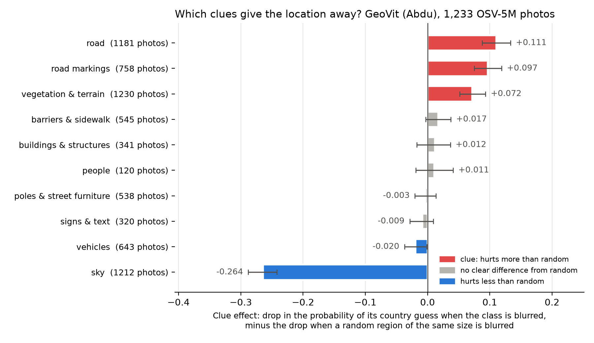

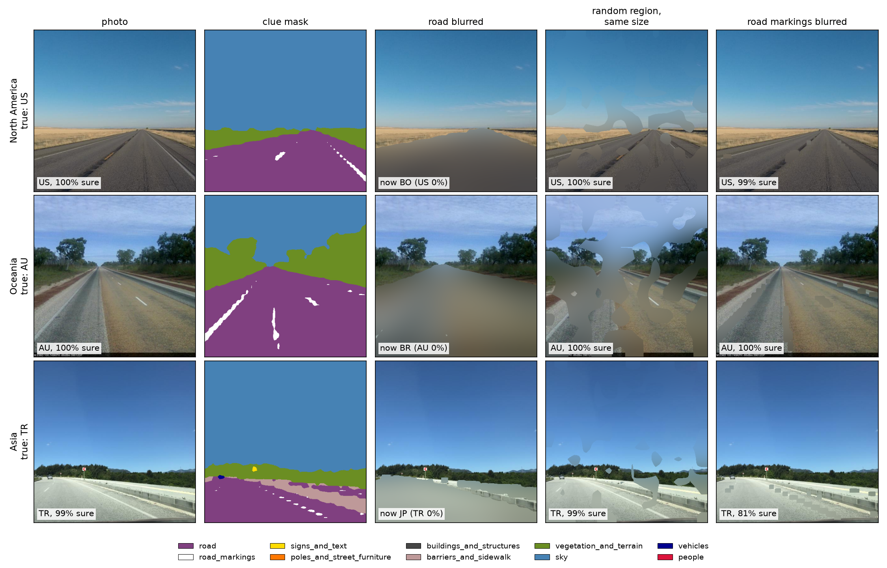

### Heat ranking (job 4405347)

| Class | Heat ratio | Excess heat (95% interval) |
|---|---:|---|
| road | 1.61 | **+0.136** (0.124 to 0.148) |
| vehicles | 1.68 | **+0.019** (0.014 to 0.025) |
| road_markings | 2.28 | **+0.012** (0.010 to 0.014) |
| barriers_and_sidewalk | 1.40 | **+0.010** (0.006 to 0.014) |
| people | 1.49 | **+0.005** (0.001 to 0.010) |
| poles_and_street_furniture | 1.43 | **+0.003** (0.001 to 0.004) |
| signs_and_text | 1.24 | -0.000 (-0.002 to 0.002) |
| buildings_and_structures | 1.21 | -0.001 (-0.007 to 0.006) |
| vegetation_and_terrain | 1.06 | **-0.016** (-0.024 to -0.009) |
| sky | 0.75 | **-0.136** (-0.149 to -0.124) |

Spearman between GeoVit's blur and heat rankings: 0.41 with excess heat, 0.32 with heat ratio
(baseline: 0.58 and 0.37).

**Where in the photo is the heat?** Share of each photo's heat in the top / middle / bottom third of the
square, averaged over all photos:

| Model | Top | Middle | Bottom |
|---|---:|---:|---:|
| OSV-5M baseline | 28% | **45%** | 27% |
| GeoVit | 24% | 29% | **47%** |

### The two models side by side

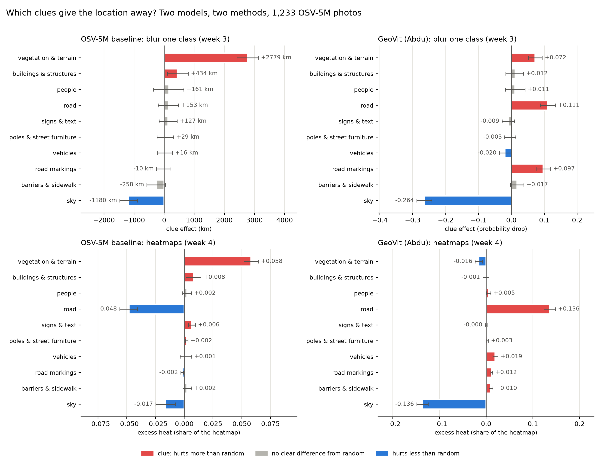

Same class order in all four panels (the baseline's blur ranking), same colours as week 3: red = clearly
more than a random region, grey = unclear, blue = clearly less.

| | OSV-5M baseline | GeoVit |
|---|---|---|
| Predicts | coordinates | one of 214 countries |
| Looks mostly at | middle of the photo: landscape, horizon | bottom of the photo: road |
| Top clues, blur | vegetation >> buildings | road, road markings, vegetation |
| Top clues, heat | vegetation, buildings, signs | road, vehicles, road markings |
| Road | ignored (last by heat) | top clue by both methods |
| Road markings | no effect | clear clue on most continents |
| Sky | least informative | least informative |

### Observations

- **The two models rely on different clues.** The baseline uses the landscape (vegetation); GeoVit uses
  the road. Both agree that the sky gives little away, and vegetation is still a clear clue for GeoVit by
  blur (+0.072), though not by heat.
- **GeoVit reads road markings.** Blurring only the markings (3% of the photo) lowers its confidence three
  times more than a random region of the same size (0.152 vs 0.055), on most continents. Line colour and
  style are national standards (yellow vs white centre lines, dashed vs solid), which fits a model that only
  has to name the country. The baseline, which has to find the exact place, gets nothing from them.
- **Possible camera-car shortcut.** OSV-5M photos come from a limited number of dashcam users, mostly one
  country each, so the bonnet and dashboard could identify the country. Some heatmaps put heat on the
  bonnet (Europe example), and vehicles (which includes the camera car) has positive excess heat. But
  blurring vehicles hurts *less* than random (-0.020), and the road markings result can't come from the
  bonnet, so the road itself is the main clue. A bottom-strip blur test would settle how much the camera
  contributes.
- **Heat and blur agree less for GeoVit** (Spearman 0.41 vs 0.58). Vegetation is the biggest
  disagreement: a clue when it is blurred as a whole, below average per window. GeoVit seems to use it as
  overall context (climate, colour) that no single window removes.
- **GeoVit is often very sure** (mean 0.78 for its own guess). For such photos no single window moves it,
  and the heatmap is close to zero (e.g. max drop 0.002 in the Asia example).

### Limitations

- The probability drop is not the same unit as km, so the two models are compared by their rankings, not
  their sizes.
- GeoVit sees the centre square, not the squashed full photo it was trained on (62.2% vs 68.5%).
- One GeoVit checkpoint and one seed of masks for its experiments.

## Week 4: the same experiments on Im2GPS

**Data:** the 237 Im2GPS photos Victoria committed on branch `privacy` (Europe 84, North America 72,
Asia 50, South America 13, Africa 11, Oceania 7). Unlike OSV-5M, these are Flickr photos taken by people:
landmarks, city streets, nature, indoor shots, food. Same code, masks from `predict.py` (segmenter_896
seed 0), both models. Jobs 4428899 (masks), 4428902/4428903 (class blur), 4428904/4428905 (heatmaps),
4428906 (GeoVit accuracy).

### How well do the models do without blur?

| Model | Im2GPS | OSV-5M (for comparison) |
|---|---|---|
| OSV-5M baseline, within 750 km | 62.0% (median error 478 km) | see week 3 |
| GeoVit, right country, centre square (top-1 / top-5) | **23.6%** / 53.2% | 62.2% / 80.8% |
| GeoVit, right country, squashed (top-1 / top-5) | 23.2% / 55.3% | 68.5% / 84.0% |
| GeoVit, mean probability of its own guess | 0.50 | 0.78 |

The baseline's 62% matches Victoria's 61% on the same photos. **GeoVit drops from 62% to 24%** on
Im2GPS (2 photos are in countries it never saw). Per continent (centre square): North America 30.6%,
Europe 25.0%, Asia 24.0%, South America 7.7%, Africa and Oceania 0%. The centre crop no longer costs
anything (23.6% vs 23.2%), so the drop comes from the photos, not from our crop.

Spearman between the blur and heat rankings (excess heat / heat ratio): baseline **0.13** / -0.09,
GeoVit **0.22** / 0.16. On OSV-5M these were 0.58 / 0.37 and 0.41 / 0.32.

### Class blur and heat, both models

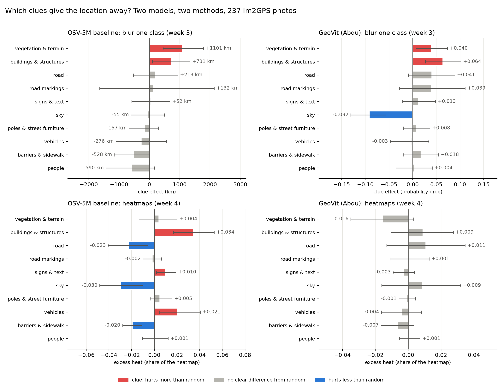

| Class | Photos | Baseline blur (km) | GeoVit blur (prob.) | Baseline heat | GeoVit heat |
|---|---:|---|---|---|---|
| vegetation_and_terrain | 204 | **+1101** | **+0.040** | +0.004 | -0.016 |
| buildings_and_structures | 192 | **+731** | **+0.064** | **+0.034** | +0.009 |
| road | 85 | +213 | +0.041 | **-0.023** | +0.011 |
| road_markings | 22 | +132 | +0.039 | -0.002 | +0.001 |
| signs_and_text | 82 | +52 | +0.013 | **+0.010** | -0.003 |
| sky | 204 | -55 | **-0.092** | **-0.030** | +0.009 |
| poles_and_street_furniture | 119 | -157 | +0.008 | +0.005 | -0.001 |
| vehicles | 80 | -276 | -0.003 | **+0.021** | -0.004 |
| barriers_and_sidewalk | 117 | -528 | +0.018 | **-0.020** | -0.007 |
| people | 89 | -590 | +0.004 | +0.001 | +0.001 |

Bold = the 95% interval excludes 0 (red or blue in the figure). Heat = excess heat.

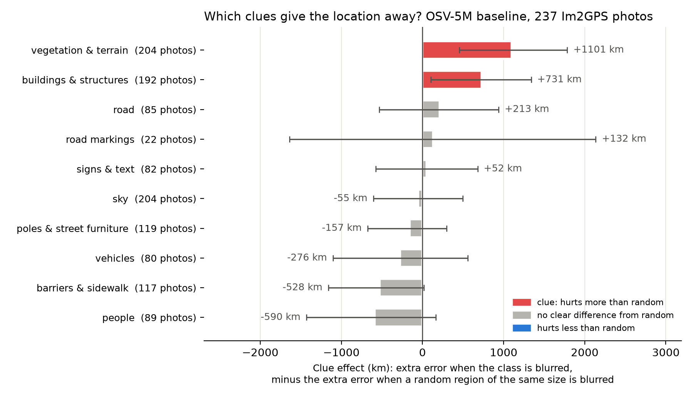

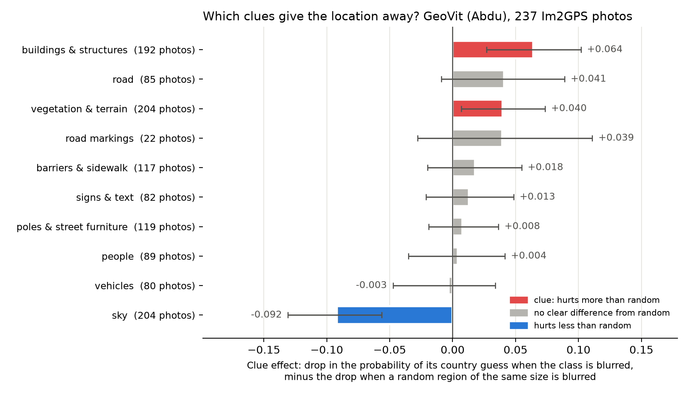

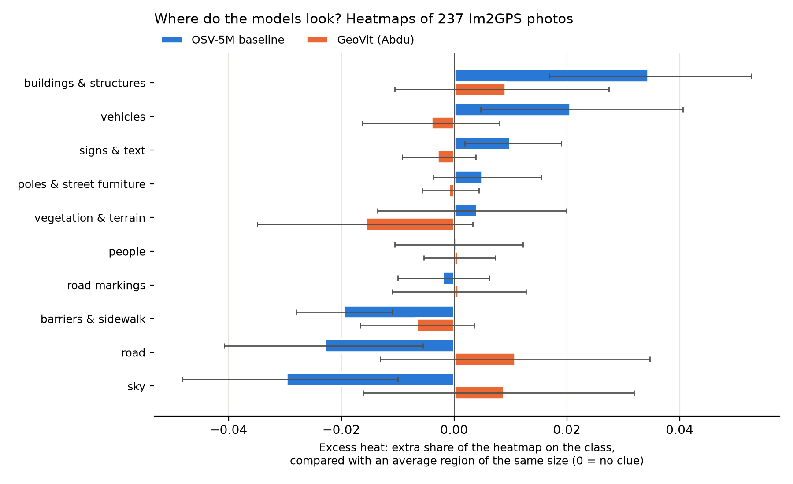

### Examples

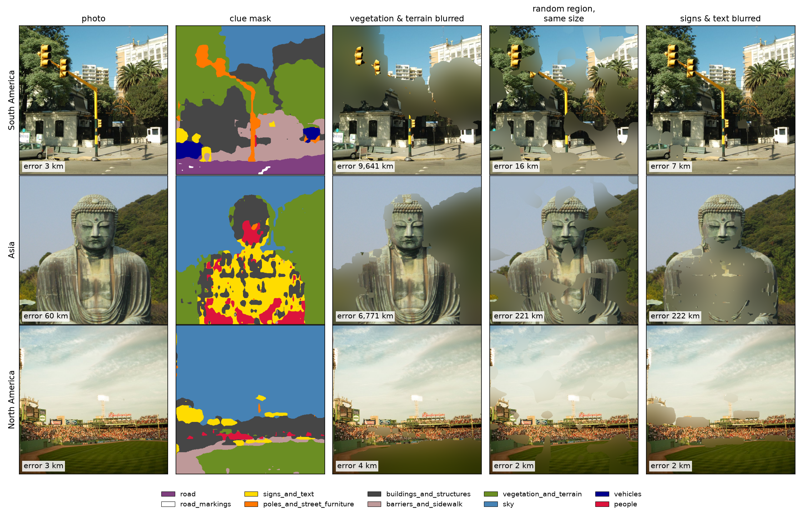

Baseline: blurring the vegetation sends Buenos Aires from 3 km to 9,641 km and the Kamakura Buddha from
60 km to 6,771 km, while a random region of the same size gives 16 km and 221 km. The baseball stadium
stays within 4 km whatever is blurred (the stands and scoreboard are enough).

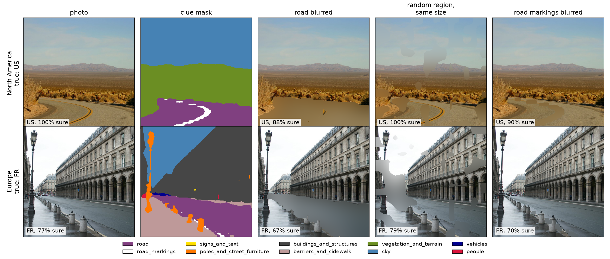

GeoVit: blurring the road only lowers its confidence (US 100% → 88%, FR 77% → 67%). On OSV-5M the
same blur flipped 100%-sure guesses to another country.

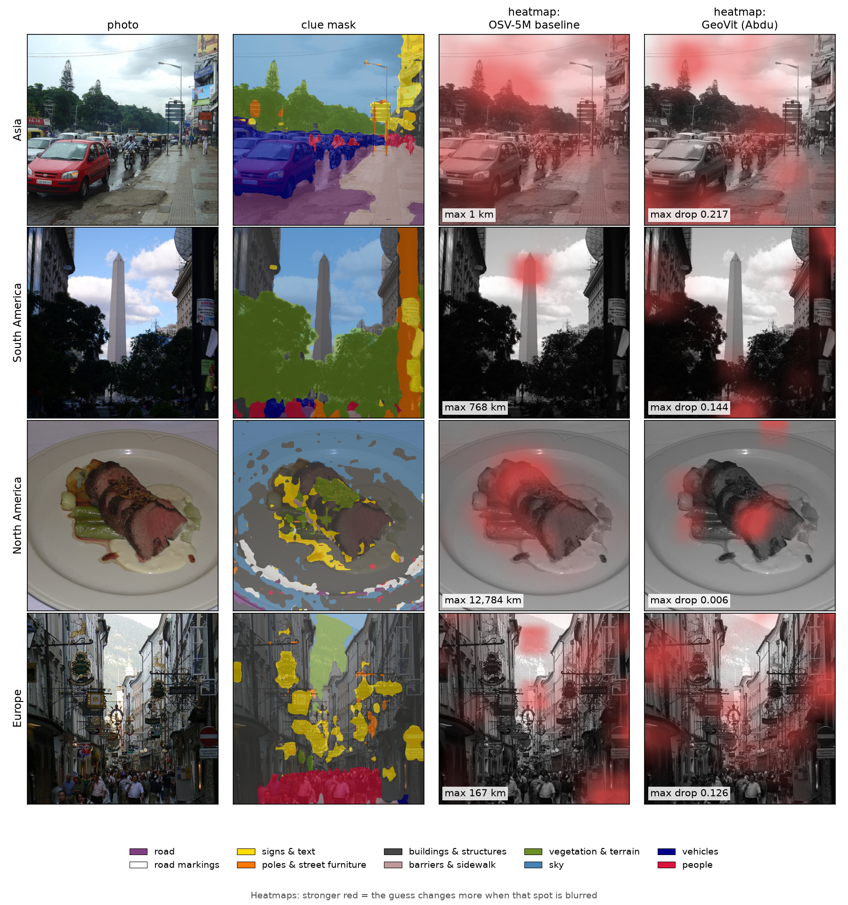

### Observations

- **On Im2GPS, both models' top clues are buildings and vegetation.** For the baseline this is the same as
  on OSV-5M (vegetation, then buildings), so its reliance on landscape transfers to tourist photos.
  GeoVit changes: buildings becomes its biggest clue (+0.064), and road and road markings are no longer
  clear clues. Most Im2GPS photos have no road (85 of 237) and almost none have markings (22), so a
  model that reads the road has to fall back on something else.
- **The models look more alike on Im2GPS than on OSV-5M.** On street-view photos their clues were
  opposite (landscape vs road). On tourist photos, where the road is rarely visible, they use the same
  things.
- **Sky:** still blue for GeoVit's blur, and for the baseline's heat. It is grey for the baseline's blur
  (-55 km), probably because sky is part of the landmark/landscape view in many Flickr photos.
- **GeoVit's Im2GPS heatmaps show no clear clue class** (all grey). Its heat is spread out and sometimes
  sits on sky or the photo edge (Asia and South America examples), so on these photos no single 64 px
  window moves it reliably. The baseline's heatmaps still show buildings, vehicles and signs.
- **Vegetation is a clue by blur for both models but not by heat**, as on OSV-5M for GeoVit: whole-class
  context that no single window removes.
- **Heat and blur barely agree on Im2GPS** (Spearman 0.13 baseline, 0.22 GeoVit, against 0.58 and 0.41
  on OSV-5M). For the baseline, vegetation is the top clue by blur and 5th by heat; vehicles are 8th by blur
  and 2nd by heat. Only buildings is near the top by both methods. On varied tourist photos, "which 64 px
  window matters" and "which whole class matters" are different questions, and blur is the one that
  matches what a privacy tool would hide.
- **GeoVit doesn't generalise to tourist photos** (24% vs 62%, mean confidence 0.50 vs 0.78). That fits
  its OSV-5M clues: road surface and road markings are rare on Im2GPS. Its Im2GPS clue ranking is
  measured on a model that is mostly wrong, so it says less about real clues than the baseline's does.
- **Per continent (small groups, read with care):** baseline buildings is a clear clue in Europe (+1,272
  km), vegetation in Europe (+1,420 km) and, by heat, in North America. GeoVit's buildings is clear in North
  America (+0.091) and vegetation in Asia (+0.112).

### Limitations

- **237 photos**, about a fifth of the OSV-5M set, so the intervals are wide and the middle of the
  ranking is unclear. Road markings (22 photos) and the small continents shouldn't be read on their own.
- **The segmenter was trained on street-level photos (Vistas)**, and its masks are worse on the rest:
  the Buddha statue is labelled signs and people, and the food photo is labelled sky and buildings.
  Classes like signs and people are therefore noisier on Im2GPS than on OSV-5M.
- GeoVit was trained on OSV-5M-like street photos, so Im2GPS is out of domain for it (24% top-1).

Crop image and train on sub crops.
Focal loss
Make sure normalized in comparison the size

Use a good frontier model for segmentation to use as a lable to compare when doing OSV-5M model.